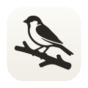
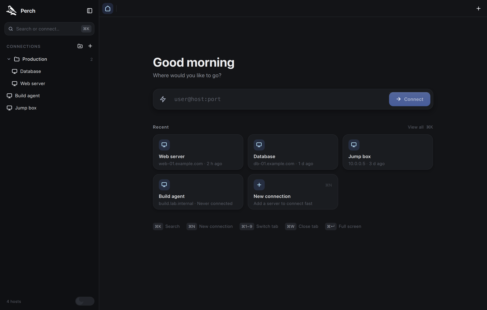
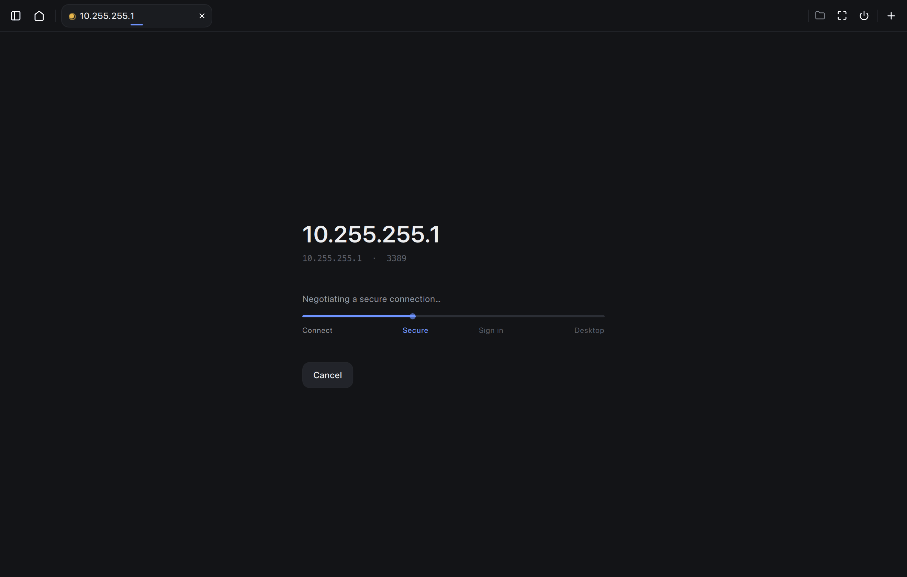
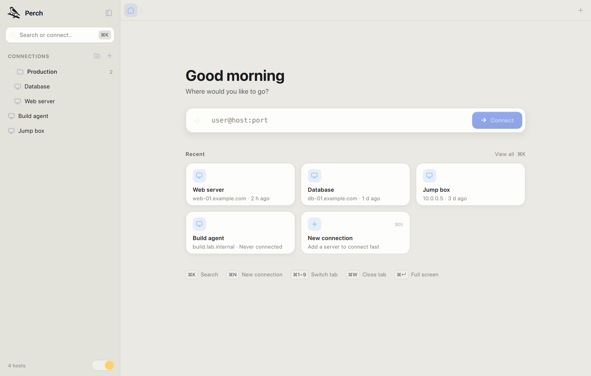

<div align="center">



# Perch

**A calm, fast remote desktop (RDP) client for macOS, Windows and Linux.**

Built with Qt 6 and FreeRDP 3.


</div>

---



Perch is a modern RDP client for people who live in remote Windows servers all
day. It keeps your connections one keystroke away, stays out of the way while
you work, and handles the slow, lossy links real infrastructure runs on.

## Features

- **Fast connect** — a quick-connect bar (`user@host:port`), saved connections
  organised into folders, recents, and fuzzy search.
- **Command palette** — `⌘K` to search hosts, run actions, and jump anywhere.
- **Credential manager** — reusable sign-in sets (username + password in the
  system keychain). Reference one from many connections; edit it once and every
  connection that uses it updates.
- **RD Gateway** — tunnel through a Remote Desktop Gateway using the same
  credentials.
- **Folder sharing** — share a local folder into the session as a redirected
  drive; add or change it live without losing your place.
- **Smoothness on real links** — UDP multitransport with FEC, H.264 / AVC444 and
  progressive GFX codecs, and QoE pacing, all negotiated with graceful fallback.
- **Session tabs & fullscreen**, dynamic resolution, auto-reconnect, clipboard,
  and **Send Ctrl+Alt+Del** (`Ctrl+Alt+End`).
- **Light & dark**, following the system appearance.

<table>
  <tr>
    <td width="50%"></td>
    <td width="50%"></td>
  </tr>
</table>

## Keyboard shortcuts

| Shortcut | Action |
| --- | --- |
| `⌘K` / `Ctrl+Alt+K` | Search / command palette |
| `⌘N` | New connection |
| `⌘1`–`⌘9` | Switch to session tab |
| `⌘W` | Close tab |
| `⌘B` | Toggle sidebar |
| `⌘↵` | Toggle fullscreen |
| `Ctrl+Alt+End` | Send Ctrl+Alt+Del to the remote |

## Building from source

Perch uses CMake with Qt 6, FreeRDP 3, and QtKeychain.

### Requirements

- CMake 3.21+ and a C++20 compiler
- Qt 6.9+ (`Gui`, `Quick`, `QuickControls2`)
- FreeRDP 3 (`freerdp`, `freerdp-client`, `winpr`)
- [QtKeychain](https://github.com/frankosterfeld/qtkeychain)

### macOS

```sh
brew install qt freerdp
# QtKeychain is small; build it against the installed Qt, or install via brew.
cmake -S . -B build -DCMAKE_PREFIX_PATH="$(brew --prefix qt)"
cmake --build build
open build/Relay.app
```

To keep the macOS keychain "Always Allow" grant across rebuilds, sign the app
with a stable identity:

```sh
cmake -S . -B build -DRELAY_CODESIGN_IDENTITY="Apple Development: Your Name (TEAMID)"
```

### Linux

```sh
sudo apt install qt6-base-dev qt6-declarative-dev freerdp3-dev libqt6keychain1 ...
cmake -S . -B build
cmake --build build
./build/relay
```

### Windows

Install Qt 6 and FreeRDP (e.g. via vcpkg), then build with CMake and MSVC. See
`.github/workflows/build.yml` for the exact, working build steps for all three
platforms.

## Status

Perch is under active development. Core RDP (connect, NLA auth, certificate
trust, GFX pipeline, input, clipboard text, dynamic resize, drive redirection,
RD Gateway) works; audio, clipboard file transfer, a client-side cursor overlay
and multi-monitor are on the roadmap.

## License

Released under the [Apache License 2.0](LICENSE). Copyright © 2026 Philemon Chiro.

If you use Perch or build on it, you must retain the attribution in [NOTICE](NOTICE)
(Apache-2.0 §4). The license also includes an explicit patent grant.
